# HOLDBACK

**Every Solana payment gets an undo window, enforced by an on-chain program.** A risk agent
sizes that window from live, cited scam evidence: no wait for people you trust, up to 24 hours
for a flagged wallet. When the recipient looks dangerous, a voice in your language explains
why, and one tap brings the money back before a scammer can claim it.

[](https://github.com/Prashant-thakur77/HOLDBACK/actions/workflows/ci.yml)

|                      |                                                                                                                                                   |
| -------------------- | ------------------------------------------------------------------------------------------------------------------------------------------------- |
| **Live site**        | https://holdback.prashantthakur.dev                                                                                                               |
| **Risk agent API**   | https://holdback-api.prashantthakur.dev                                                                                                           |
| **Program (devnet)** | [`26Tx1zAiL26RfxqTAVDaFaD2TTVku4Hm2vy3LBw8unom`](https://explorer.solana.com/address/26Tx1zAiL26RfxqTAVDaFaD2TTVku4Hm2vy3LBw8unom?cluster=devnet) |
| **A real receipt**   | [hold `GAVEL3zT…fhgWrg`](https://holdback.prashantthakur.dev/h/GAVEL3zT8wQDsS1LimSsaABMu4m8w4skmsmsz4fhgWrg): assessed, held, undone              |
| **Blink**            | `https://holdback.prashantthakur.dev/api/actions/pay?to=<address>&amount=<n>`                                                                     |
| **Status**           | Devnet, unaudited. See [what has run where](#what-has-run-where).                                                                                 |

## The problem

Payments on Solana are final in under a second. That is the feature scammers rely on.

|                               |                                                                                                                      |
| ----------------------------- | -------------------------------------------------------------------------------------------------------------------- |
| **Rs 22,845.73 crore**        | Reported by Indian citizens as lost to cyber fraud in 2024, about 206% more than in 2023                             |
| **About $17 billion**         | Chainalysis' estimate of crypto stolen in scams and fraud in 2025; the average scam payment rose from $782 to $2,764 |
| **$11.37 billion**            | Cryptocurrency-related losses reported to the FBI in 2025                                                            |
| **More than Rs 11,158 crore** | Saved in India since 2021 by stopping fraudulent transfers after a prompt report                                     |

The last row is the point. Where a payment can still be stopped, money comes back: India's
reporting system, Brazil's Pix return mechanism and the UK's payment-delay rule all work
that way. On-chain there is no such moment. HOLDBACK adds one, and makes it exactly as long
as the evidence about the recipient justifies. Sources and scope for every figure:
[docs/REFERENCES.md](docs/REFERENCES.md).

## How it works

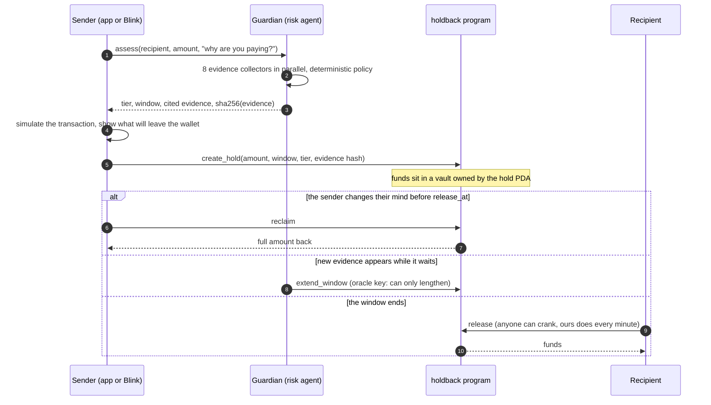

### The life of a hold

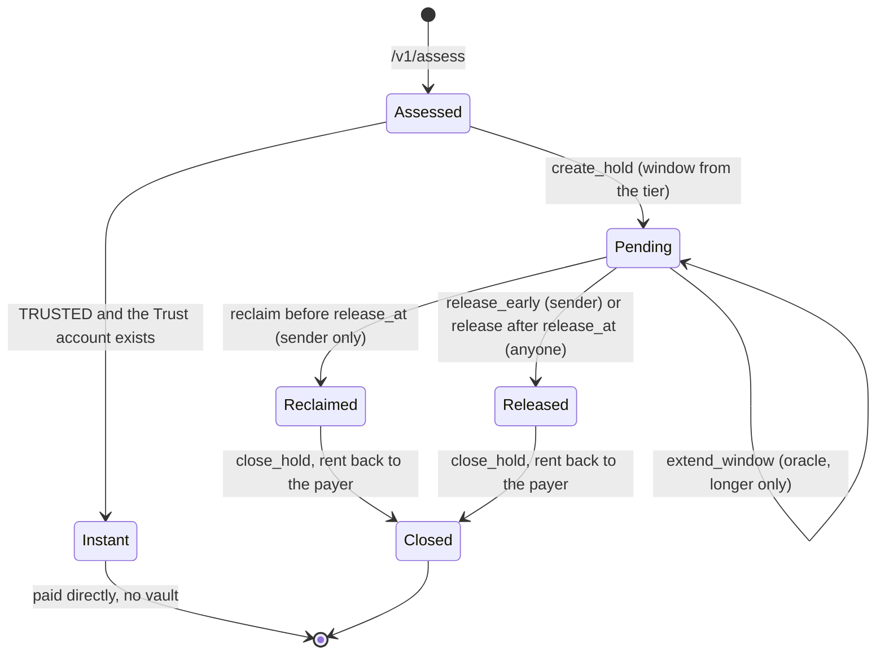

### How the risk agent decides

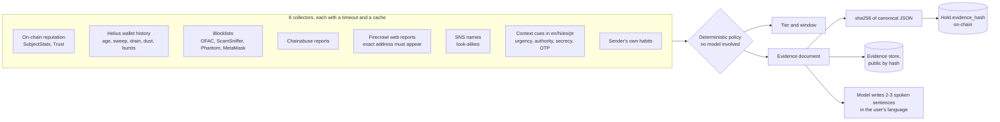

| Tier       | When                                         | Window                            |
| ---------- | -------------------------------------------- | --------------------------------- |
| TRUSTED    | The sender's on-chain `Trust` account exists | none                              |
| UNKNOWN    | Default                                      | 30 minutes                        |
| SUSPICIOUS | Score 30–59                                  | 6 hours                           |
| FLAGGED    | Score 60+, or a confirmed scam report        | 24 hours                          |
| SANCTIONED | On the sanctions list                        | 72 hours, plus typed confirmation |

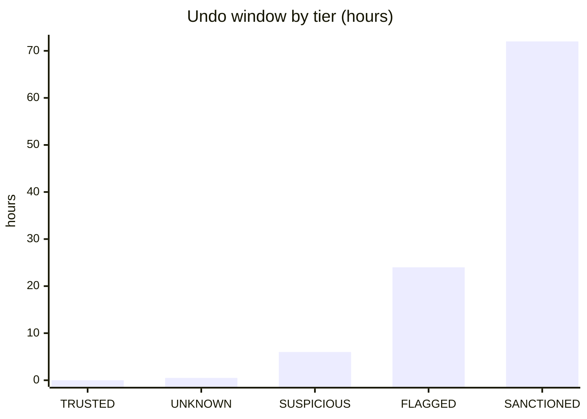

The language model never decides a tier or a window. It extracts quotes from web pages and
writes the spoken explanation; both outputs are schema-validated, and a fixed template in each
language is used when the model is unavailable.

## Verifiable by design

**The evidence hash.** `Hold.evidence_hash` is `sha256(canonicalJson(document))`. The receipt
page fetches the document, recomputes the hash in the browser and compares it with the chain.
If they match, the window was set from exactly that evidence by exactly that policy version,
and nobody can have changed it afterwards.

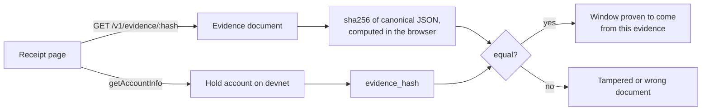

**Service keys are boxed in by the program, not by promises.**

| Key                                                | Can                                                                                                                | Cannot                                                    |
| -------------------------------------------------- | ------------------------------------------------------------------------------------------------------------------ | --------------------------------------------------------- |
| Risk oracle                                        | Lengthen a running window (up to 72 h after creation), raise the tier                                              | Move funds, shorten a window, re-lock a window that ended |
| Relayer (for wallets that can only make transfers) | Return a deposit box's funds to its owner; open a hold whose sender is the owner, with at least the default window | Pay itself or a third party, release early                |
| Admin                                              | Rotate keys, change limits, pause new holds                                                                        | Touch any vault; pausing never blocks undo or release     |

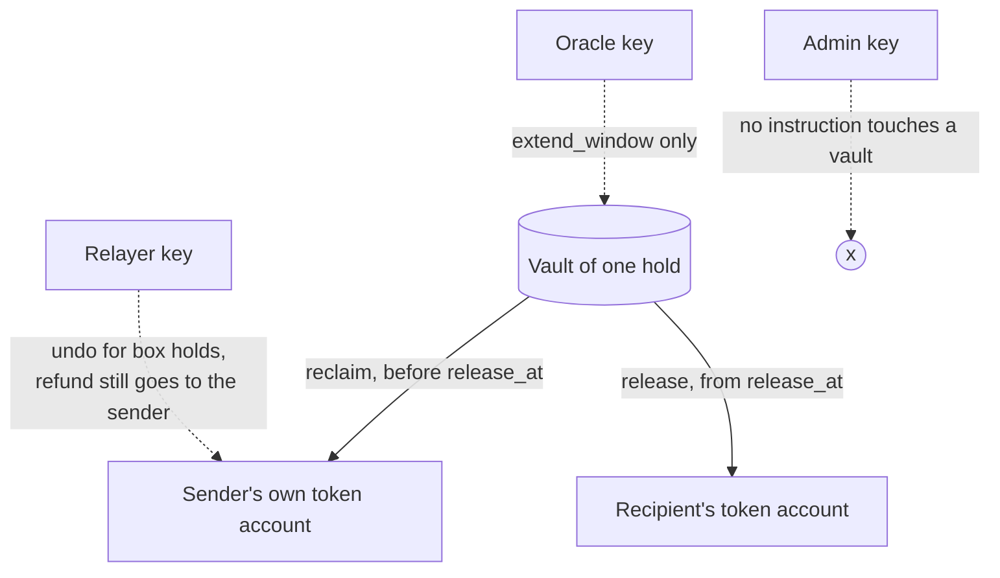

**Six invariants, checked after every instruction of a property test:** funds leave a vault
only to the sender or the recipient; nothing reaches the recipient early unless the sender
signs; the oracle never moves funds or shortens a window; the relayer only pays the box owner
or opens a hold for them; supply is conserved; every settled hold can be closed with its rent
returned. Full analysis: [docs/THREAT_MODEL.md](docs/THREAT_MODEL.md).

## Architecture

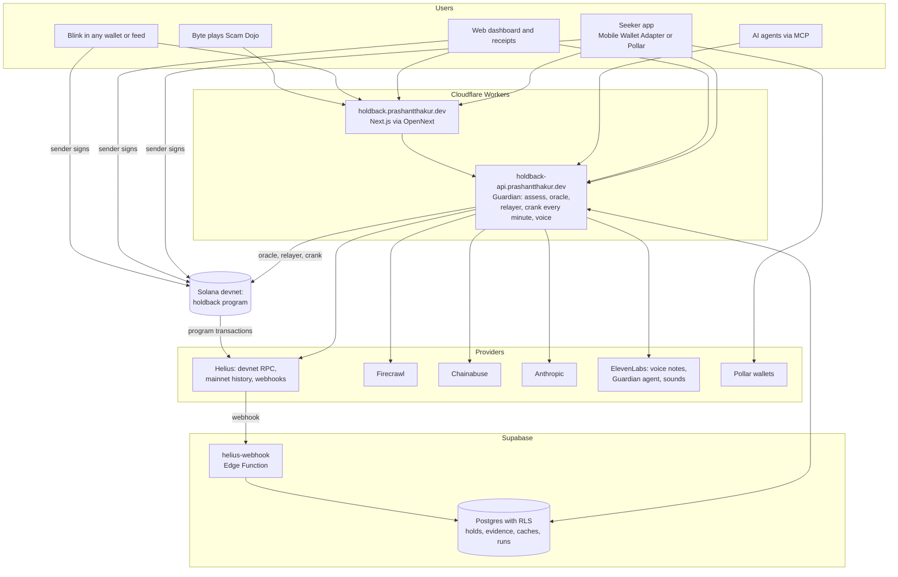

More detail: [docs/ARCHITECTURE.md](docs/ARCHITECTURE.md).

## Results

Every number below is produced by a script and stored in `eval/results.json`
(`make eval` regenerates it; CI fails if this section is out of date).

<!-- results:start -->

Run of 2026-11-27 at commit `2b17d25`. Held-out means first published on or after 2026-07-01.

| Metric                                                     | Static blocklist                                     | HOLDBACK                             |
| ---------------------------------------------------------- | ---------------------------------------------------- | ------------------------------------ |
| Recall on held-out scam addresses                          | 0/3 (0.0%, 95% CI 0.0% to 56.1%)                     | 3/3 (100.0%, 95% CI 43.9% to 100.0%) |
| Recall without the label’s own list (independent evidence) | n/a                                                  | 0/3 (0.0%, 95% CI 0.0% to 56.1%)     |
| False-positive rate on legit addresses                     | 0/54 (0.0%, 95% CI 0.0% to 6.6%)                     | 1/54 (1.9%, 95% CI 0.3% to 9.8%)     |
| Precision                                                  | no rows (n = 0)                                      | 3/4 (75.0%, 95% CI 30.1% to 95.4%)   |
| Scam value protected, sender reacts after 10 min           | 0.0% blocked (0/3); the rest is a plain transfer, 0% | 100.0% reclaimable (3/3 payments)    |
| Scam value protected, sender reacts after 1 h              | 0.0% blocked (0/3); the rest is a plain transfer, 0% | 100.0% reclaimable (3/3 payments)    |
| Scam value protected, sender reacts after 6 h              | 0.0% blocked (0/3); the rest is a plain transfer, 0% | 100.0% reclaimable (3/3 payments)    |
| Scam value protected, sender reacts after 24 h             | 0.0% blocked (0/3); the rest is a plain transfer, 0% | 100.0% reclaimable (3/3 payments)    |
| Median time to verdict                                     | n/a                                                  | 8,834 ms (n = 102)                   |
| `/v1/assess`, first request                                | n/a                                                  | p50 4,020 ms, p95 13,474 ms (n = 30) |
| `/v1/assess`, repeat request                               | n/a                                                  | p50 2,292 ms, p95 9,780 ms (n = 30)  |
| `create_hold` to confirmed, devnet                         | n/a                                                  | p50 1,046 ms, p95 2,108 ms (n = 5)   |
| `reclaim` to confirmed, devnet                             | n/a                                                  | p50 2,500 ms, p95 2,589 ms (n = 5)   |

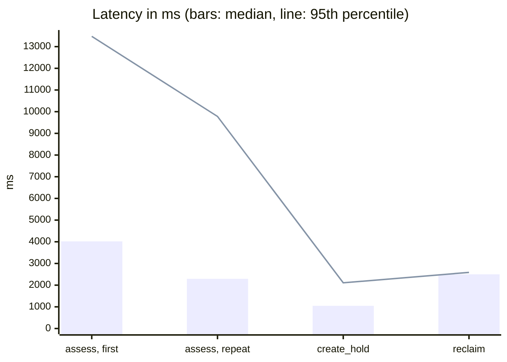

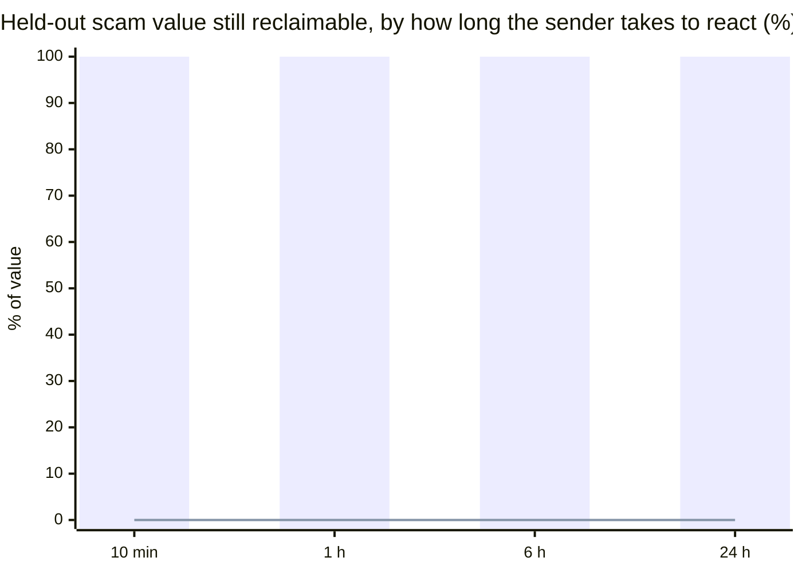

Bars: HOLDBACK. Line: a plain transfer, which cannot be reclaimed at any delay.

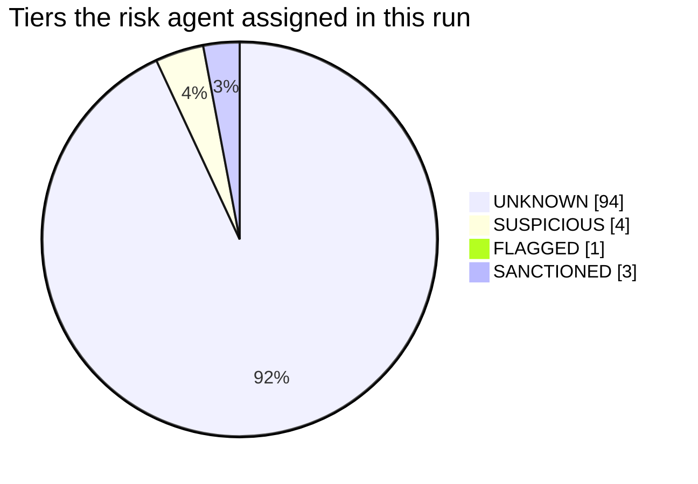

Every scam label comes from a public list that the `blocklist` collector also reads, so recall above repeats the label; without that list the Guardian caught 0 of 3. Dataset sources that could not be used: `chainabuse`. The numbers describe that configuration and nothing more; [`eval/RESULTS.md`](eval/RESULTS.md) lists every limit and the full tables.

**Where it fails.** A wallet created less than a day ago, with no reports and little or no history, gives the Guardian nothing to find. Of 44 such wallets (new mainnet wallets and never-used keypairs, none of them a known scam) it rated 4/44 (9.1%, 95% CI 3.6% to 21.2%) as suspicious or worse. What still helps is the default window: every one of them got 30 min, 6 h, 24 h, so a payment to them could still be undone for 44/44 (100.0%) after 10 min, 4/44 (9.1%) after 1 h, 1/44 (2.3%) after 6 h, 0/44 (0.0%) after 24 h. The gap that remains: a victim who notices after the default window has closed gets nothing back, exactly as with a plain transfer.

Program property test: 100,000 random cases, 609,726 instructions, 0 invariant violations.

<!-- results:end -->

## On-chain program

Anchor 1.x, SPL Token and Token-2022 through `token_interface`, native SOL.

| Account        | Seeds                            | Purpose                                               |
| -------------- | -------------------------------- | ----------------------------------------------------- |
| `Config`       | `["config"]`                     | Admin, relayer, oracle, window limits, pause switch   |
| `Hold`         | `["hold", sender, nonce_le_u64]` | One protected payment                                 |
| Vault          | ATA(mint, owner = Hold)          | The tokens; SOL sits in the Hold account              |
| `Trust`        | `["trust", sender, recipient]`   | "Sender trusts recipient"                             |
| `DepositBox`   | `["box", owner]`                 | Inbox for wallets that can only make transfers        |
| `Flag`         | `["flag", reporter, subject]`    | One scam report per reporter per subject              |
| `SubjectStats` | `["stats", subject]`             | Flags, holds received, reclaimed-against, released-to |

`SubjectStats.holds_reclaimed_against` counts how often senders pulled money back from an
address. It is a scam signal no blocklist has, because it only exists where payments can be
undone.

Instructions: `initialize_config`, `update_config`, `create_hold`, `create_hold_sol`,
`instant_transfer`, `instant_transfer_sol`, `init_deposit_box`, `open_hold_from_deposit`,
`withdraw_deposit`, `extend_window`, `reclaim`, `reclaim_sol`, `release`, `release_early`,
`release_sol`, `release_early_sol`, `set_trust`, `remove_trust`, `flag_subject`, `close_hold`.

Devnet addresses: program `26Tx1zAiL26RfxqTAVDaFaD2TTVku4Hm2vy3LBw8unom`, config
`Cz9e3k72qaDnQJNo6deUXVdE823HcFrhkV36Zj92s9tw`.

**Reproducible build.** The deployed program is the output of a deterministic Docker build of
this repository, and anyone can check it:

```bash
solana-verify build --library-name holdback \
  --base-image solanafoundation/solana-verifiable-build:4.3.0
solana-verify get-executable-hash target/deploy/holdback.so
solana-verify get-program-hash -u devnet 26Tx1zAiL26RfxqTAVDaFaD2TTVku4Hm2vy3LBw8unom
# both print 37786c0607f141edcb22f53fa4cb35b12221b428722949056f7dd53f9f0b22f5
```

The public verification registry only covers mainnet, so on devnet the check is this local
comparison.

## What is in this repository

| Path                | What it is                                                                                                           |
| ------------------- | -------------------------------------------------------------------------------------------------------------------- |
| `programs/holdback` | The program, 30 LiteSVM tests with clock warping, and the invariant property test                                    |
| `tests/`            | 13 localnet integration scenarios through the public SDK                                                             |
| `sdk/`              | `@holdback/sdk`: IDL-driven codec, PDAs, instruction builders, decoders, event parser, evidence hashing, API client  |
| `services/agent/`   | `@holdback/guardian`: collectors, policy, evidence store, oracle, relayer, cranker, voice, push (Cloudflare Workers) |
| `mcp/`              | `@holdback/mcp`: Model Context Protocol server so AI agents pay through holds instead of irreversible transfers      |
| `apps/mobile/`      | Seeker app: Mobile Wallet Adapter and Pollar wallets, voice Guardian, Scam Dojo                                      |
| `apps/web/`         | Site, dashboard, public receipts, Solana Action / Blink, Dojo API and watch page (Cloudflare Workers via OpenNext)   |
| `dojo/`             | `@holdback/dojo`: Scam Dojo, a deterministic 8-round game over 65 scenarios                                          |
| `supabase/`         | Schema with row-level security, the `helius-webhook` function, housekeeping                                          |
| `eval/`, `bench/`   | Dataset builder, blocklist baseline, metrics, replay, latency                                                        |
| `docs/`             | Architecture, threat model, decisions, references, demo script                                                       |

## Integrations

| Partner                    | What HOLDBACK uses it for                                                                                                 | Where                                                                                  | Live proof                                                            |
| -------------------------- | ------------------------------------------------------------------------------------------------------------------------- | -------------------------------------------------------------------------------------- | --------------------------------------------------------------------- |
| **Solana Mobile / Seeker** | Native Android app; Mobile Wallet Adapter signs holds, undo, early release, trust and reports; Seeker Genesis Token badge | `apps/mobile`                                                                          | Signed release APK in Releases                                        |
| **Pollar**                 | Seedless wallets that can only make transfers pay through an on-chain deposit box                                         | `apps/mobile/src/wallet`, `programs/holdback` (`DepositBox`), `services/agent` (relay) | Publishable key accepted by Pollar for native clients; Solana enabled |
| **ElevenLabs**             | Voice notes in hi/en/es/pt for risky holds; the "Holdback Guardian" voice agent with five tools; three sound effects      | `services/agent/src/voice`, `apps/mobile/src/voice`                                    | Agent created; a live Hindi voice note served and cached              |
| **Firecrawl**              | Search and scrape web reports that name the exact address; Dojo report collector                                          | `services/agent/src/collectors`, `dojo/scripts`                                        | Live `/v1/assess` with the web-reports collector answering            |
| **Supabase**               | Evidence by hash, mirror of holds, caches, Dojo runs; RLS; Edge Function for Helius                                       | `supabase/`                                                                            | Webhook mirrored a live hold from PENDING to RECLAIMED                |
| **Helius**                 | Private devnet RPC for Workers, mainnet wallet history, program webhook                                                   | `services/agent`, `supabase/functions`                                                 | Crank released a hold from inside Workers                             |
| **Byte**                   | Scam Dojo: 8 rounds, real risk agent behind `check_address`, score written to devnet                                      | `dojo/`, `apps/web`                                                                    | Live run, memo `5HDADarV…iSpep`                                       |
| **AI agents (MCP)**        | `assess_recipient`, `send_protected_payment`, `undo_payment` and 7 more tools; fails closed                               | `mcp/`                                                                                 | 45 tests                                                              |

### Pollar: undo for wallets that can only send

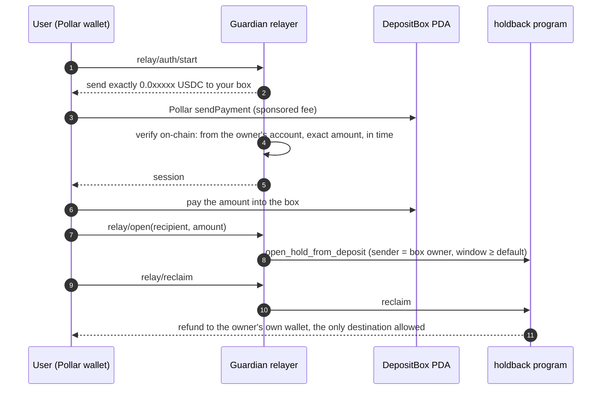

### ElevenLabs: a warning people actually hear

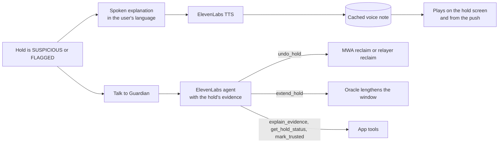

Guardrails in the agent's instructions: it never tells the user to send money, never asks for
or repeats seed phrases or one-time codes, and steers to undo when the user mentions police or
arrest calls, remote-access apps or "verification payments".

### Firecrawl: only evidence that names the address

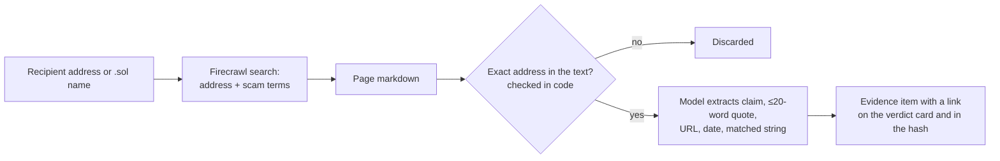

### Supabase: a mirror the chain can always overrule

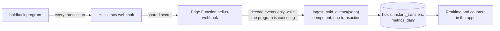

### Byte: Scam Dojo

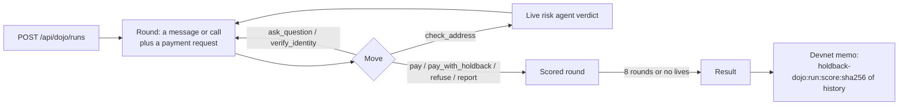

## What has run where

| Part               | Verified                                                                                                                                                                          | Not yet                                                        |
| ------------------ | --------------------------------------------------------------------------------------------------------------------------------------------------------------------------------- | -------------------------------------------------------------- |
| Program            | 30 Rust tests, 100,000-case property test, 13 localnet scenarios; deployed on devnet; on-chain hash equals the reproducible Docker build                                          | Audit; mainnet                                                 |
| Live stack         | Assess, create hold, webhook mirror, evidence hash check, undo, receipt page, all on the deployed services; crank release and close inside Workers; a full Dojo run with its memo | A device run of the APK                                        |
| Guardian           | 248 tests; deployed on Workers with rate limits and one cron trigger                                                                                                              | The outbound phone call (needs a Twilio number)                |
| Webhook and schema | 56 decoder tests; deployed; mirrors live holds                                                                                                                                    | Realtime from the apps (needs the project's legacy JWT secret) |
| Web                | 109 tests; deployed; Lighthouse mobile 98–100 in every category                                                                                                                   | A Blink unfurl in a third-party client                         |
| Mobile app         | 137 tests; signed release APK built against the live services and published in Releases                                                                                           | Any run on a device or emulator                                |
| MCP server         | 45 tests                                                                                                                                                                          | Signing on a real cluster                                      |
| Scam Dojo          | 101 tests; live run with memo                                                                                                                                                     | Upload to Byte                                                 |

## Run it

```bash
npm install                      # sdk, dojo, mcp, guardian
anchor build && npm run idl:sync
cargo test -p holdback           # Rust tests + 2,000-case property test
npm run program:fuzz             # 100,000 cases -> eval/program_invariants.json
npm run program:test:localnet    # integration tests on a local validator
npm test                         # all TypeScript packages
make eval                        # dataset, baseline, metrics, bench, this README's results
```

Each service has its own README and `.env.example`: [services/agent](services/agent),
[apps/web](apps/web), [apps/mobile](apps/mobile), [supabase](supabase), [mcp](mcp),
[dojo](dojo), [eval](eval). Research and official figures behind the design:
[docs/REFERENCES.md](docs/REFERENCES.md).

## Limits and roadmap

- The window buys time and a warning. A sender who waits it out is not protected.
- Fee-on-transfer and transfer-hook mints are refused. Tokens an issuer can freeze can be
  stuck while frozen.
- Wallets that cannot sign program instructions depend on the relayer to undo.
- Next: an audit and mainnet, sender-side reputation, Pix and UPI on- and off-ramps through
  Pollar, and a "safe send" SDK for wallets to embed.

## License

MIT
