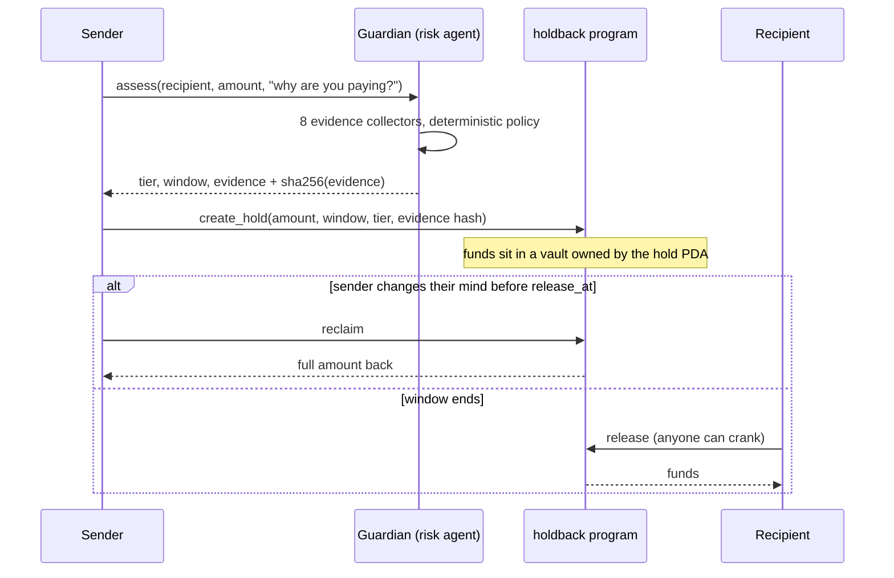

# HOLDBACK

**Every Solana payment gets an undo window, enforced by an on-chain program.** A risk agent
sizes that window from live, cited scam evidence: no wait for people you trust, up to 24 hours
for a flagged wallet. When the recipient looks dangerous, a voice in your language explains
why, and one tap brings the money back before a scammer can claim it.

- Program (devnet): [`26Tx1zAiL26RfxqTAVDaFaD2TTVku4Hm2vy3LBw8unom`](https://explorer.solana.com/address/26Tx1zAiL26RfxqTAVDaFaD2TTVku4Hm2vy3LBw8unom?cluster=devnet)
- Status: devnet, unaudited. [What has run where](#what-has-run-where) is listed honestly below.

## The problem

Payments on Solana are final in under a second. That is the feature scammers rely on.

|                               |                                                                                                                      |
| ----------------------------- | -------------------------------------------------------------------------------------------------------------------- |
| **Rs 22,845.73 crore**        | Reported by Indian citizens as lost to cyber fraud in 2024, about 206% more than in 2023                             |
| **About $17 billion**         | Chainalysis' estimate of crypto stolen in scams and fraud in 2025; the average scam payment rose from $782 to $2,764 |
| **$11.37 billion**            | Cryptocurrency-related losses reported to the FBI in 2025                                                            |
| **More than Rs 11,158 crore** | Saved in India since 2021 by stopping fraudulent transfers after a prompt report                                     |

The last row is the point. Where a payment can still be stopped, money comes back: India's
reporting system, Brazil's Pix return mechanism and the UK's payment-delay rule all work
that way. On-chain there is no such moment. HOLDBACK adds one, and makes it exactly as long
as the evidence about the recipient justifies. Sources and scope for every figure:
[docs/REFERENCES.md](docs/REFERENCES.md).

## How it works



1. **Assess.** Eight collectors run in parallel: on-chain reputation, wallet-history
   heuristics, blocklists and the sanctions list, abuse reports, web reports that mention the
   exact address, name look-alikes, social-engineering cues in the sender's own words, and
   the sender's own payment habits.
2. **Decide.** A deterministic policy turns the evidence into a tier and a window. The
   language model never decides either; it only writes the spoken explanation.

   | Tier       | When                                         | Window                            |
   | ---------- | -------------------------------------------- | --------------------------------- |
   | TRUSTED    | The sender's on-chain `Trust` account exists | none                              |
   | UNKNOWN    | Default                                      | 30 minutes                        |
   | SUSPICIOUS | Score 30–59                                  | 6 hours                           |
   | FLAGGED    | Score 60+, or a confirmed scam report        | 24 hours                          |
   | SANCTIONED | On the sanctions list                        | 72 hours, plus typed confirmation |

3. **Commit.** The evidence document is hashed and the hash is written into the hold, so the
   window can be checked against the evidence forever (see below).
4. **Hold.** The sender signs. Until `release_at` only the sender can move the funds, and
   only back to the sender.
5. **Undo or settle.** One signature undoes it. Otherwise anyone can release to the recipient
   once the window is over; a cranker does it every minute.

More detail: [docs/ARCHITECTURE.md](docs/ARCHITECTURE.md).

## Verifiable by design

**The evidence hash.** `Hold.evidence_hash` is `sha256(canonicalJson(document))`. The receipt
page fetches the document, recomputes the hash in the browser and compares it with the chain.
If they match, the window was set from exactly that evidence by exactly that policy version,
and nobody can have changed it afterwards.

**Service keys are boxed in by the program, not by promises.**

| Key                                                | Can                                                                                                                | Cannot                                                    |
| -------------------------------------------------- | ------------------------------------------------------------------------------------------------------------------ | --------------------------------------------------------- |
| Risk oracle                                        | Lengthen a running window (up to 72 h after creation), raise the tier                                              | Move funds, shorten a window, re-lock a window that ended |
| Relayer (for wallets that can only make transfers) | Return a deposit box's funds to its owner; open a hold whose sender is the owner, with at least the default window | Pay itself or a third party, release early                |
| Admin                                              | Rotate keys, change limits, pause new holds                                                                        | Touch any vault; pausing never blocks undo or release     |

**Six invariants, checked after every instruction of a property test:** funds leave a vault
only to the sender or the recipient; nothing reaches the recipient early unless the sender
signs; the oracle never moves funds or shortens a window; the relayer only pays the box owner
or opens a hold for them; supply is conserved; every settled hold can be closed with its rent
returned. Full analysis: [docs/THREAT_MODEL.md](docs/THREAT_MODEL.md).

## Results

Every number below is produced by a script and stored in `eval/results.json`
(`make eval` regenerates it; CI fails if this table is out of date).

<!-- results:start -->

Run of 2026-11-27 at commit `9966f61`. Held-out means first published on or after 2026-07-01.

| Metric                                           | Static blocklist                                     | HOLDBACK                          |
| ------------------------------------------------ | ---------------------------------------------------- | --------------------------------- |
| Recall on held-out scam addresses                | 0/3 (0.0%, 95% CI 0.0% to 56.1%)                     | 0/3 (0.0%, 95% CI 0.0% to 56.1%)  |
| False-positive rate on legit addresses           | 0/54 (0.0%, 95% CI 0.0% to 6.6%)                     | 0/54 (0.0%, 95% CI 0.0% to 6.6%)  |
| Precision                                        | no rows (n = 0)                                      | no rows (n = 0)                   |
| Scam value protected, sender reacts after 10 min | 0.0% blocked (0/3); the rest is a plain transfer, 0% | 100.0% reclaimable (3/3 payments) |
| Scam value protected, sender reacts after 1 h    | 0.0% blocked (0/3); the rest is a plain transfer, 0% | 0.0% reclaimable (0/3 payments)   |
| Scam value protected, sender reacts after 6 h    | 0.0% blocked (0/3); the rest is a plain transfer, 0% | 0.0% reclaimable (0/3 payments)   |
| Scam value protected, sender reacts after 24 h   | 0.0% blocked (0/3); the rest is a plain transfer, 0% | 0.0% reclaimable (0/3 payments)   |
| Median time to verdict                           | n/a                                                  | 389 ms (n = 102)                  |
| `/v1/assess`, first request                      | n/a                                                  | p50 253 ms, p95 340 ms (n = 30)   |
| `/v1/assess`, repeat request                     | n/a                                                  | p50 132 ms, p95 148 ms (n = 30)   |
| `create_hold` to confirmed, devnet               | n/a                                                  | p50 890 ms, p95 1,063 ms (n = 5)  |
| `reclaim` to confirmed, devnet                   | n/a                                                  | p50 834 ms, p95 989 ms (n = 5)    |

In this run these evidence collectors were unavailable for every assessment: `baseline`, `blocklist`, `chainabuse`, `helius`, `web_reports`. Dataset sources that could not be used: `chainabuse`. The numbers describe that configuration and nothing more; [`eval/RESULTS.md`](eval/RESULTS.md) lists every limit and the full tables.

**Where it fails.** A wallet created less than a day ago, with no reports and little or no history, gives the Guardian nothing to find. Of 44 such wallets (new mainnet wallets and never-used keypairs, none of them a known scam) it rated 0/44 (0.0%, 95% CI 0.0% to 8.0%) as suspicious or worse. What still helps is the default window: every one of them got 30 min, so a payment to them could still be undone for 44/44 (100.0%) after 10 min, 0/44 (0.0%) after 1 h, 0/44 (0.0%) after 6 h, 0/44 (0.0%) after 24 h. The gap that remains: a victim who notices after the default window has closed gets nothing back, exactly as with a plain transfer.

Program property test: 100,000 random cases, 609,726 instructions, 0 invariant violations.

<!-- results:end -->

## On-chain program

Anchor 1.x, SPL Token and Token-2022 through `token_interface`, native SOL.

| Account        | Seeds                            | Purpose                                               |
| -------------- | -------------------------------- | ----------------------------------------------------- |
| `Config`       | `["config"]`                     | Admin, relayer, oracle, window limits, pause switch   |
| `Hold`         | `["hold", sender, nonce_le_u64]` | One protected payment                                 |
| Vault          | ATA(mint, owner = Hold)          | The tokens; SOL sits in the Hold account              |
| `Trust`        | `["trust", sender, recipient]`   | "Sender trusts recipient"                             |
| `DepositBox`   | `["box", owner]`                 | Inbox for wallets that can only make transfers        |
| `Flag`         | `["flag", reporter, subject]`    | One scam report per reporter per subject              |
| `SubjectStats` | `["stats", subject]`             | Flags, holds received, reclaimed-against, released-to |

`SubjectStats.holds_reclaimed_against` counts how often senders pulled money back from an
address. It is a scam signal no blocklist has, because it only exists where payments can be
undone.

Instructions: `initialize_config`, `update_config`, `create_hold`, `create_hold_sol`,
`instant_transfer`, `instant_transfer_sol`, `init_deposit_box`, `open_hold_from_deposit`,
`withdraw_deposit`, `extend_window`, `reclaim`, `reclaim_sol`, `release`, `release_early`,
`release_sol`, `release_early_sol`, `set_trust`, `remove_trust`, `flag_subject`, `close_hold`.

Devnet addresses: program `26Tx1zAiL26RfxqTAVDaFaD2TTVku4Hm2vy3LBw8unom`, config
`Cz9e3k72qaDnQJNo6deUXVdE823HcFrhkV36Zj92s9tw`.

**Reproducible build.** The deployed program is the output of a deterministic Docker build of
this repository, and anyone can check it:

```bash
solana-verify build --library-name holdback \
  --base-image solanafoundation/solana-verifiable-build:4.3.0
solana-verify get-executable-hash target/deploy/holdback.so
solana-verify get-program-hash -u devnet 26Tx1zAiL26RfxqTAVDaFaD2TTVku4Hm2vy3LBw8unom
# both print 37786c0607f141edcb22f53fa4cb35b12221b428722949056f7dd53f9f0b22f5
```

The public verification registry only covers mainnet, so on devnet the check is this local
comparison.

## What is in this repository

| Path                | What it is                                                                                                           |
| ------------------- | -------------------------------------------------------------------------------------------------------------------- |
| `programs/holdback` | The program, 30 LiteSVM tests with clock warping, and the invariant property test                                    |
| `tests/`            | 13 localnet integration scenarios through the public SDK                                                             |
| `sdk/`              | `@holdback/sdk`: IDL-driven codec, PDAs, instruction builders, decoders, event parser, evidence hashing, API client  |
| `services/agent/`   | `@holdback/guardian`: collectors, policy, evidence store, oracle, relayer, cranker, voice, push (Cloudflare Workers) |
| `mcp/`              | `@holdback/mcp`: Model Context Protocol server so AI agents pay through holds instead of irreversible transfers      |
| `apps/mobile/`      | Seeker app: Mobile Wallet Adapter and Pollar wallets, voice Guardian, Scam Dojo                                      |
| `apps/web/`         | Site, dashboard, public receipts, Solana Action / Blink, Dojo API and watch page (Cloudflare Workers via OpenNext)   |
| `dojo/`             | `@holdback/dojo`: Scam Dojo, a deterministic 8-round game over 65 scenarios                                          |
| `supabase/`         | Schema with row-level security, the `helius-webhook` function, housekeeping                                          |
| `eval/`, `bench/`   | Dataset builder, blocklist baseline, metrics, replay, latency                                                        |
| `docs/`             | Architecture, threat model, decisions, references, demo script                                                       |

## Integrations

**Solana Mobile / Seeker.** Native Android app built from the official template. Users sign
holds, undo, early release, trust and flags directly through Mobile Wallet Adapter. A
"Verified Seeker owner" badge comes from a server-side Seeker Genesis Token check.

**Pollar.** A Pollar wallet can send tokens to an address and nothing else. The user pays into
their own on-chain deposit box; the relayer opens the hold and can only ever return funds to
the owner. Login is a proof by transfer: send an exact random amount to your own box.

**ElevenLabs.** The "Holdback Guardian" voice agent speaks Hindi, English, Spanish and
Portuguese, explains the evidence behind a hold and can trigger undo. Suspicious and flagged
holds get a generated voice note.

**Firecrawl.** Searches the web for reports about the recipient and scrapes the results. A
source counts only if its text contains the exact address; that check is done in code, not by
the model.

**Supabase.** Evidence documents, a Realtime mirror of holds for countdowns, caches and
profiles, with row-level security and service-role writes only.

**Byte.** Scam Dojo: eight rounds of real-world payment requests, about 40% of them
legitimate, where `check_address` runs the real risk agent. The run result is written to
devnet as a memo.

**AI agents.** The MCP server exposes `assess_recipient`, `send_protected_payment`,
`undo_payment` and seven more tools. It fails closed: no risk verdict, no payment.

## What has run where

| Part               | Verified                                                                                           | Not yet                                                                                                                 |
| ------------------ | -------------------------------------------------------------------------------------------------- | ----------------------------------------------------------------------------------------------------------------------- |
| Program            | 30 Rust tests, 100,000-case property test, 13 localnet scenarios, deployed and exercised on devnet | Audit; reproducible Docker build                                                                                        |
| SDK                | 27 unit tests; used by every other package                                                         |                                                                                                                         |
| Guardian           | 221 tests; create, oracle extend, crank release and close, and a Dojo memo on devnet under Node    | Inside the Workers runtime with a private RPC; live calls to Helius, Chainabuse, Firecrawl, ElevenLabs; a real database |
| Webhook and schema | 56 decoder tests; migrations and end-to-end ingest against a local Postgres                        | A hosted project, a real Helius delivery, Realtime                                                                      |
| MCP server         | 45 tests; binary lists its tools                                                                   | Signing on a real cluster                                                                                               |
| Web                | 88 tests; Action, Dojo API and headers under the Workers runtime locally                           | Deployment; a wallet in a browser; a Blink client                                                                       |
| Mobile app         | 137 unit tests; typecheck, lint, `expo-doctor` and prebuild pass; signed arm64 release APK builds  | Any run on a device or emulator: wallet connect and signing, Pollar, voice, push are unexercised                        |
| Scam Dojo          | 101 tests; a full run over HTTP                                                                    | Upload to Byte; the report collector (needs a Firecrawl key)                                                            |

## Run it

```bash
npm install                      # sdk, dojo, mcp, guardian
anchor build && npm run idl:sync
cargo test -p holdback           # Rust tests + 2,000-case property test
npm run program:fuzz             # 100,000 cases -> eval/program_invariants.json
npm run program:test:localnet    # integration tests on a local validator
npm test                         # all TypeScript packages
make eval                        # dataset, baseline, metrics, bench, README table
```

Each service has its own README and `.env.example`: [services/agent](services/agent),
[apps/web](apps/web), [apps/mobile](apps/mobile), [supabase](supabase), [mcp](mcp),
[dojo](dojo), [eval](eval).

## Limits and roadmap

- The window buys time and a warning. A sender who waits it out is not protected.
- Fee-on-transfer and transfer-hook mints are refused. Tokens an issuer can freeze can be
  stuck while frozen.
- Wallets that cannot sign program instructions depend on the relayer to undo.
- Next: an audit and mainnet, sender-side reputation, Pix and UPI on- and off-ramps through
  Pollar, and a "safe send" SDK for wallets to embed.

## License

MIT
