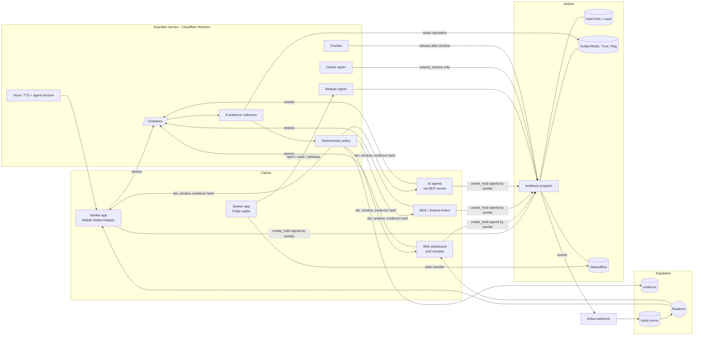

# Architecture

HOLDBACK has one job: give the sender of a payment a period in which the payment can be
undone, and make that period as long as the evidence about the recipient demands. The parts
below exist to do that and nothing else.

## The life of a payment

1. **Assess.** The client sends `{sender, recipient, mint, amount, context?, lang}` to the
   Guardian. Eight collectors run in parallel, each with its own timeout and cache: on-chain
   reputation, wallet history heuristics, static blocklists and the sanctions list, abuse
   reports, web reports that mention the exact address, name look-alikes, social-engineering
   cues in the sender's own words, and the sender's own payment habits. A collector that does
   not answer in time is recorded as unavailable and contributes nothing.
2. **Decide.** A deterministic policy turns the evidence into findings, a score, a tier and a
   window. No language model takes part in this step.

   | Tier | When | Window |
   | --- | --- | --- |
   | TRUSTED | The sender's `Trust` account exists, or 3+ past releases to this recipient and no flags | none |
   | UNKNOWN | Default | 30 minutes |
   | SUSPICIOUS | Score 30–59 | 6 hours |
   | FLAGGED | Score 60+, or a confirmed scam report | 24 hours |
   | SANCTIONED | On the sanctions list | 72 hours, and the app asks for typed confirmation |

3. **Commit to the evidence.** The Guardian builds an evidence document (policy version,
   parties, amount, score, tier, window, findings, evidence items, unavailable collectors),
   serializes it as canonical JSON and hashes it with sha256. The document is stored by hash;
   the 32-byte hash goes into the transaction.
4. **Preview and sign.** The client builds the transaction with the SDK, simulates it without
   signatures and shows what will leave the wallet. The sender signs `create_hold`. The funds
   move into a vault owned by a PDA derived from the sender and a nonce. The hold records the
   parties, amount, `release_at`, tier and evidence hash.
5. **Wait, with a way out.** Until `release_at` the sender can undo with one signature and
   the full amount returns to the sender's own account. If new evidence appears, the oracle
   can lengthen the window. A voice note explains the warning in the sender's language, and
   the sender can talk to the voice agent, which can trigger the same undo.
6. **Settle.** From `release_at` anyone can call `release`; the cranker does it every minute.
   The funds go to the recipient's token account. `close_hold` returns the rent.

Trusted recipients skip steps 4–6: `instant_transfer` pays them directly and requires the
`Trust` account in its constraints.

## Why the evidence hash matters

A risk score that cannot be checked is an opinion. Here, the window a user was given is tied
to a public document:

- the document is fetched from `GET /v1/evidence/:hash`;
- the receipt page recomputes `sha256(canonicalJson(document))` in the browser;
- the result is compared with `Hold.evidence_hash` read from the chain.

If they match, the window was set from exactly that evidence by exactly that policy version,
and neither the service nor anyone else can have changed it afterwards. `canonicalJson`
sorts object keys and drops `undefined`, so the same content always gives the same bytes; it
is implemented once in the SDK and used by the Guardian, the web app, the MCP server and the
eval scripts.

## On-chain design

Accounts (all PDAs, bump stored):

| Account | Seeds | Purpose |
| --- | --- | --- |
| `Config` | `["config"]` | Admin, relayer, oracle, window limits, pause switch |
| `Hold` | `["hold", sender, nonce_le_u64]` | One protected payment |
| Vault | ATA(mint, owner = Hold) | Holds the tokens; SOL sits in the Hold account itself |
| `Trust` | `["trust", sender, recipient]` | Existence means "sender trusts recipient" |
| `DepositBox` | `["box", owner]` | Inbox for wallets that can only make transfers |
| `Flag` | `["flag", reporter, subject]` | One scam report per reporter per subject |
| `SubjectStats` | `["stats", subject]` | Flags, holds received, reclaimed-against, released-to |

Design choices worth knowing:

- **A vault per payment.** Reversible-token designs keep "pending" balances inside the
  recipient's account and must handle partial spends, pooled balances and zombie entries.
  Here the money never reaches the recipient until the window is over, so none of those
  states exist.
- **`release_at` is stored per hold.** Changing the config never changes a running window.
- **Release is permissionless.** The recipient never depends on the sender or on our
  service to get paid.
- **Reputation is a by-product.** `holds_reclaimed_against` counts how often senders pulled
  money back from an address. It costs nothing extra to maintain and is a scam signal no
  blocklist has, because it only exists where payments can be undone.
- **Service keys are boxed in by constraints,** not by policy. See `THREAT_MODEL.md`.

## Wallets that cannot sign program instructions

Seedless embedded wallets (Pollar) can send tokens to an address and nothing else. For them:

1. The relayer creates the owner's `DepositBox` and its token account.
2. The owner proves control of the wallet without signing a message: the Guardian asks for a
   transfer of an exact, random amount into the owner's own box and verifies on-chain that
   the owner's token account sent it. That yields a session.
3. To pay, the owner transfers into the box and asks the Guardian to open a hold. The program
   takes the hold's sender from the box, never from instruction data.
4. Undo and withdraw return funds to the owner's own wallet; the relayer has no other
   destination available.

## Off-chain services

| Part | Runs on | Role |
| --- | --- | --- |
| Guardian (`services/agent`) | Cloudflare Workers, Hono | Assessment, policy, evidence store, oracle, relayer, cranker (Cron Trigger), voice, push |
| `helius-webhook` | Supabase Edge Function | Decodes program events from Helius webhooks into the `holds` mirror and daily metrics |
| Supabase | Postgres + Realtime | Evidence documents, hold mirror, caches, profiles, Dojo runs; row-level security, service-role writes only |
| Web (`apps/web`) | Cloudflare Workers via OpenNext | Site, dashboard, public receipts, Solana Action, Dojo API and watch page |
| MCP server (`mcp`) | Local process (stdio) | Lets AI agents assess recipients and pay through holds |

Nothing off-chain can move funds on its own. If every service is down, a wallet that can sign
can still undo, release and close with the SDK.

## Packages

| Package | Depends on | Notes |
| --- | --- | --- |
| `@holdback/sdk` | web3.js, noble hashes | IDL-driven codec, PDAs, builders, decoders, events, evidence hashing, API client |
| `@holdback/guardian` | sdk | The service above |
| `@holdback/dojo` | none | Deterministic game engine and Fetch-API handler |
| `@holdback/mcp` | sdk | Model Context Protocol tools |
| `apps/web`, `apps/mobile` | sdk, dojo | Standalone apps linking the local packages |
| `eval`, `bench` | Guardian API, sdk | Dataset, baseline, metrics, replay, latency |
